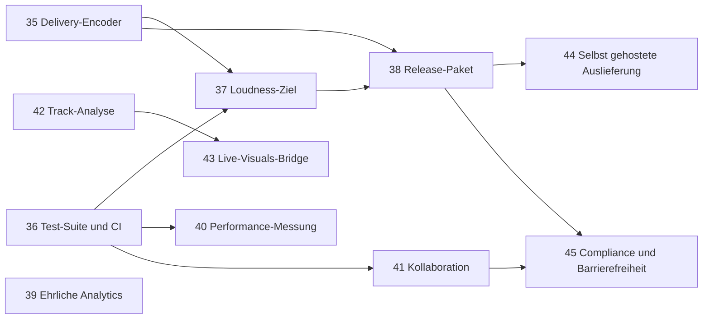

# Beat Architekt: Roadmap Phase 35 bis 45

Stand: 2026-11-26, Basis `main` nach #304 und #305.

Diese Roadmap leitet sich aus einer Bestandsaufnahme der Phasen 30 bis 34 ab. Leitlinie: Jede Phase ersetzt eine Attrappe durch eine messbar funktionierende Implementierung oder schliesst eine Luecke, die Auslieferung, Live-Einsatz oder Compliance blockiert. Neue Panels ohne echte Funktion sind ausdruecklich nicht Teil der Roadmap.

## 1. Bestandsaufnahme Phase 30 bis 34

| Bereich | Stand im Code | Bewertung |
|---|---|---|
| 30.1 Metering, Loudness, True Peak | BS.1770-4 mit Gating, True Peak nach Annex 2, Live-Limiter (#289, #292 bis #297) | echt, gegen EBU Tech 3341 geprueft |
| 30.2 Multi-Format-Export | Bis Phase 35: nur WAV echt. MP3 bekam Float- statt Int16-Samples, AIFF war WAV-Inhalt mit FORM-Kopf, Opus ohne Ogg-Container, AAC lieferte WAV unter `.aac`, `embedMetadata()` war leer | Phase 35 behebt das |
| 30.2 Loudness-Ziel | Normalisierung, danach Limiter; bei hohem Crest-Faktor verfehlt der Export das Ziel deutlich (Messung Phase 35: -16,4 statt -14 LUFS bei 11 dB Gain-Reduktion) | Luecke, Phase 37 |
| 30.3 Distribution | `authenticatePlatform()` ist ein Stub, kein Upload. `generateISRCCode()` erzeugt zufaellige ISRCs mit erfundenem Registrant-Code (`US-JJY-..`) | Attrappe, Phase 38; zufaellige ISRCs sind fachlich falsch |
| 30.4 / 32 Analytics | `fetchSpotifyMetrics()` u. a. erzeugen Werte mit `Math.random()` (71 Aufrufe in der Datei) | Attrappe, Phase 39 |
| 31 Performance | "CPU" ist die Bildzeit der UI-Schleife relativ zu 16,67 ms, nicht die Audio-Renderlast; `updatePerformanceMetrics()` ist doppelt definiert | irrefuehrend, Phase 40 |
| 33 Kollaboration | Sitzungen und Praesenz nur im Speicher eines Tabs (`collaborationState.sessions`), kein Transport | Simulation, Phase 41 |
| 34 Setlist | Kurator arbeitet auf einem festen 20-Track-Pool mit hinterlegten BPM/Key-Werten | Heuristik ohne Audioanalyse, Phase 42 |
| Tests | Alle Browser- und Messtests dieser Phasen liegen ausserhalb des Repos; CI prueft nur den HTML-Build | Luecke, Phase 36 |

## 2. Abhaengigkeiten

Reihenfolge-Empfehlung: 35, 36, 37, 38, 42, 40, 39, 41, 43, 44, 45. Phase 36 steht frueh, weil jede weitere Phase ihre Abnahme sonst wieder ausserhalb des Repos fuehrt.

## 3. Phasen

### Phase 35: Delivery-Encoder (in Arbeit)

Ziel: Jede exportierte Datei ist, was ihre Endung verspricht, und traegt die Release-Metadaten.

Umfang: WAV und AIFF mit 16/24 Bit und TPDF-Dither; MP3 ueber lamejs mit ID3v2.4 (inkl. Cover, ISRC); AAC ueber WebCodecs im M4A-Container mit iTunes-Tags und Edit-Liste; Opus ueber WebCodecs im Ogg-Container nach RFC 7845; neues Preset "Web-Stream (Opus)"; keine stille WAV-Ersatzdatei mehr, Fehler mit Grund in der Export-Queue.

Abnahme: ffprobe erkennt Codec, Rate, Kanaele und Tags; Rueckdecodierung mit ffmpeg: PCM maximal 1,6 LSB Abweichung, MP3 und Opus mindestens 25 dB SNR, Opus ohne Versatz und mit exakter Laenge; M4A-Muxer liefert dieselben Samples wie der ADTS-Ausgangsstrom.

### Phase 36: Test-Suite und CI

Ziel: Die Abnahmetests aller Phasen laufen im Repo und bei jedem PR.

Umfang: `demos/beat-architekt/tests/` mit Playwright-Tests (Metering, LUFS nach EBU 3341, True Peak, Limiter, Recorder, Export inkl. ffprobe-Pruefung, Crossfade, KI-Mix); gemeinsamer Test-Server und Helfer; GitHub-Actions-Job nur fuer Aenderungen unter `demos/beat-architekt/`, mit Chromium und ffmpeg.

Abnahme: Job laeuft unter 10 Minuten; ein absichtlich eingebauter Fehler (z. B. falsches Granule in Ogg) laesst ihn rot werden.

### Phase 37: Loudness-Ziel zuverlaessig treffen

Ziel: Exporte treffen das Ziel des Presets auf +/-0,5 LU, ohne die True-Peak-Grenze zu verletzen.

Umfang: Iteration aus Gain, Limiter und Messung (hoechstens 3 Durchlaeufe) im Export-Worker; Warnung, wenn die noetige Gain-Reduktion ueber 6 dB liegt (Material zu dynamisch fuer das Ziel); Anzeige von Ziel, Ist-Wert und Gain-Reduktion je Datei.

Abnahme: Testmaterial mit 6, 12 und 18 dB Crest-Faktor landet bei -14 LUFS auf +/-0,5 LU und unter -1,0 dBTP; Warnung erscheint nur beim 18-dB-Fall.

### Phase 38: Release-Paket statt Upload-Attrappe

Ziel: Ein Paket, das ein Distributor annehmen kann, statt eines simulierten Uploads.

Hintergrund: Spotify, Apple Music und YouTube Music bieten keine oeffentliche Upload-API fuer Kuenstler; die Auslieferung laeuft ueber Distributoren.

Umfang: Export als ZIP mit Audio (WAV 24 Bit), Cover, Metadaten als DDEX-ERN-XML und lesbarem Datenblatt; Validierung: ISRC-Format (CC-XXX-YY-NNNNN) aus Nutzereingabe, UPC/EAN mit Pruefziffer, Cover mindestens 3000 x 3000 px, RGB, JPEG/PNG; `generateISRCCode()` entfaellt (ISRCs vergibt der Registrant); OAuth-Attrappen und Fantasie-Endpunkte werden entfernt.

Abnahme: ZIP besteht ein XML-Schema-Check gegen ERN; fehlerhafte ISRC/UPC und zu kleine Cover werden mit Begruendung abgelehnt.

### Phase 39: Ehrliche Analytics

Ziel: Keine erfundenen Zahlen mehr.

Umfang: Zufallsdaten in 30.4/32 entfernen; Import von CSV-Berichten aus Distributor-Dashboards mit Spaltenzuordnung; Diagramme nur aus importierten Daten; ohne Import ein leerer Zustand mit Hinweis statt Demo-Zahlen.

Abnahme: `Math.random()` kommt in Analytics-Code nicht mehr vor; ein Beispiel-CSV ergibt reproduzierbare Kennzahlen.

### Phase 40: Echte Performance-Messung

Ziel: Die Anzeige misst die Audio-Last, nicht die Bildwiederholrate.

Umfang: Renderzeit je Quantum im AudioWorklet relativ zum Budget (128 Samples bei 48 kHz = 2,67 ms); Dropout-Zaehler; Long Tasks ueber `PerformanceObserver`; doppelte `updatePerformanceMetrics()` zusammenfuehren.

Abnahme: Kuenstliche Last im Worklet erhoeht die Anzeige nachvollziehbar; UI-Last allein veraendert die Audio-Last-Anzeige nicht.

### Phase 41: Kollaboration ueber Tabs und Geraete

Ziel: Zwei Instanzen teilen Pattern, Kommentare und Praesenz.

Umfang: Stufe 1 `BroadcastChannel` zwischen Tabs; Stufe 2 CRDT-Dokument (Yjs) mit WebSocket-Relay hinter Reverse Proxy mit Authentifizierung; Rollenpruefung aus Phase 33 auf echte Operationen anwenden.

Abnahme: Gleichzeitige Bearbeitung desselben Steps in zwei Tabs konvergiert ohne Datenverlust; ein Viewer kann nichts schreiben.

### Phase 42: Track-Analyse fuer Setlists

Ziel: Der Kurator arbeitet mit gemessenen BPM- und Tonartwerten.

Umfang: Analyse importierter Audiodateien im Worker (Onset-Funktion und Autokorrelation fuer BPM, Chroma mit Tonartprofilen fuer Key); Ergebnis in Camelot-Notation; Rekordbox-XML lesen und schreiben (BPM, Key, Cue-Punkte).

Abnahme: Referenzset mit bekannten Werten: BPM auf +/-0,5 genau bei mindestens 90 % der Tracks, Tonart inkl. relativer Moll/Dur bei mindestens 75 %; Rekordbox-Roundtrip ohne Verlust.

### Phase 43: Live-Visuals-Bridge

Ziel: Audioreaktive Daten fuer TouchDesigner und Resolume.

Umfang: Kleine lokale Bridge (Node) von WebSocket auf OSC/UDP; gesendet werden Baender, Onsets, Beat-Phase und Lautheit mit Zeitstempel; Latenzmessung Browser zu Bridge.

Abnahme: TouchDesigner-Beispiel-TOX reagiert auf Kick-Onsets; End-zu-End-Latenz unter 20 ms im lokalen Netz.

### Phase 44: Selbst gehostete Auslieferung

Ziel: Release-Pakete auf eigener Infrastruktur bereitstellen.

Umfang: Pinning ueber einen eigenen IPFS-Knoten; die API (Port 5001) ist nie oeffentlich, Zugriff nur ueber Reverse Proxy mit Authentifizierung; Content-Hash und Pruefsumme im Release-Paket; optional Zugangskontrolle ueber Token.

Abnahme: Paket ist ueber das Gateway abrufbar, Hash stimmt; ein Portscan zeigt 5001 geschlossen.

### Phase 45: Compliance und Barrierefreiheit

Ziel: Datenschutz, KI-Transparenz und Bedienbarkeit dokumentiert und umgesetzt.

Umfang: DSGVO/revDSG: Verzeichnis der lokal gespeicherten Daten (localStorage, IndexedDB), Export und Loeschung auf Knopfdruck; EU AI Act Art. 50: einheitliche Kennzeichnung KI-erzeugter Inhalte (Setlist, KI-Mix-Empfehlungen, Muster) auch in Exportdateien; Barrierefreiheit der Panels (Tastatur, Fokus, ARIA-Labels).

Abnahme: Datenexport und Loeschung vollstaendig nachweisbar; axe-core ohne kritische Befunde auf allen Panels.

## 4. Arbeitsweise

- Jede Phase als eigener Draft-PR gegen `main`, Commits mit Sign-off (DCO).
- Gestapelte PRs nur, wenn eine Phase den Code der vorigen braucht; nach jedem Merge wird die Basis des naechsten PRs auf `main` umgestellt, bevor er gemergt wird.
- Abnahmekriterien werden ab Phase 36 als Tests im Repo umgesetzt.
